# 🐝 Katalog Resmi Lengkap Maskot Otbee HD (OTWPTN)

Koleksi lengkap **78 pose, sudut pandang, dan komposisi maskot Otbee** dalam format **High Definition (HD)** dengan **background transparan (RGBA)** bersih tanpa sisa halo putih.

Direktori ini dirancang agar **Claude / developer / desainer** dapat dengan mudah mencari dan menggunakan maskot yang tepat sesuai konteks fitur atau halaman UI.

---

## 📂 Lokasi File & Format
- **Format**: PNG Transparan (RGBA 32-bit), HD Super Resolution
- **Folder Master Maskot**: `/Maskot/hd-transparent/`
- **Folder Public Web (Next.js)**: `/public/mascot-hd/`, `/public/mascot/`, `/public/fitur/`
- **Cara Import di Next.js / React**:
  ```tsx
  import Image from 'next/image';

  // Opsi 1: Menggunakan nama pose deskriptif bahasa Indonesia
  <Image src="/mascot-hd/maskot-bersama-robot-ai.png" alt="Otbee AI" width=220 height=240 />

  // Opsi 2: Menggunakan slug singkat bahasa Inggris
  <Image src="/mascot/ai-robot.png" alt="Otbee AI" width=220 height=240 />

  // Opsi 3: Ikon fitur khusus di dashboard
  <Image src="/fitur/otbee-ai.png" alt="Fitur Otbee AI" width=180 height=180 />
  ```

---

## 📑 Daftar Lengkap 78 Aset Maskot & Panduan Konteks UI

| No | Preview | Nama File Indonesia | Nama File EN (Slug) | Kategori | Konteks Penggunaan UI yang Direkomendasikan |
| :-: | :-: | :--- | :--- | :--- | :--- |
| 1 |  | `maskot-jempol-rekomendasi.png` | `thumbsup.png` | **Persetujuan & Rekomendasi** | Halaman konfirmasi sukses, rekomendasi paket belajar, tombol CTA persetujuan, review positif, atau ucapan 'Mantap!' |
| 2 |  | `maskot-terbang-pensil.png` | `pencil-fly.png` | **Mulai Menulis & Ujian** | Tombol 'Mulai Tulis Esai', sesi pengerjaan tryout/ujian, modul latihan soal, draft baru. |
| 3 |  | `maskot-pegang-ijazah.png` | `diploma.png` | **Kelulusan & Sertifikasi** | Halaman penerimaan mahasiswa baru, sertifikat tryout selesai, bukti kelulusan seleksi jalur mandiri/SNBP/SNBT. |
| 4 |  | `maskot-baca-buku-tumpuk.png` | `reading-books.png` | **Materi & Modul Belajar** | Menu perpustakaan materi, bank soal, modul teori, rangkuman materi pelajaran, sesi literasi. |
| 5 |  | `maskot-koreksi-nilai-a.png` | `grading-paper.png` | **Hasil & Skor Tinggi** | Hasil review esai memuaskan, nilai tryout di atas passing grade, rapor unggul, evaluasi belajar tuntas. |
| 6 |  | `maskot-piala-toga-juara.png` | `trophy-graduate.png` | **Prestasi Puncak & Wisuda** | Pengumuman lolos PTN impian, juara 1 leaderboard tryout nasional, perayaan wisuda pejuang PTN. |
| 7 |  | `maskot-petualang-mendaki.png` | `hiking.png` | **Perjalanan & Eksplorasi** | Awal perjalanan persiapan PTN, eksplorasi profil kampus & jurusan, onboarding langkah awal, track belajar. |
| 8 |  | `maskot-lolos-ptn-loncat.png` | `lulus-ptn.png` | **Perayaan & Sambutan** | Welcome screen pengguna baru, pengumuman hasil seleksi lolos, ucapan selamat atas pencapaian target. |
| 9 |  | `maskot-bingung-garuk-kepala.png` | `confused.png` | **Bantuan & Error State** | Halaman Error 404, belum memilih jurusan, butuh panduan/FAQ, materi belum dikuasai, form belum lengkap. |
| 10 |  | `maskot-customer-service-headset.png` | `support-headset.png` | **Layanan Bantuan & CS** | Pusat bantuan (Help Center), live chat admin, konsultasi privat, tombol hubungi tim support. |
| 11 | 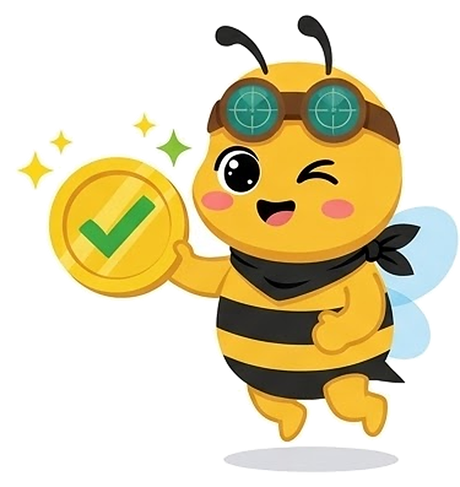 | `maskot-kedip-centang-oke.png` | `winking-check.png` | **Verifikasi & Syarat Terpenuhi** | Berkas terverifikasi, akun aktif, pembayaran berhasil, syarat administrasi tuntas, status 'Aman'. |
| 12 |  | `maskot-tidur-lelap-bantal.png` | `sleeping.png` | **Istirahat & Jam Malam** | Pesan istirahat cukup malam hari, fitur sedang maintenance/istirahat, sesi belajar selesai untuk hari ini. |
| 13 | 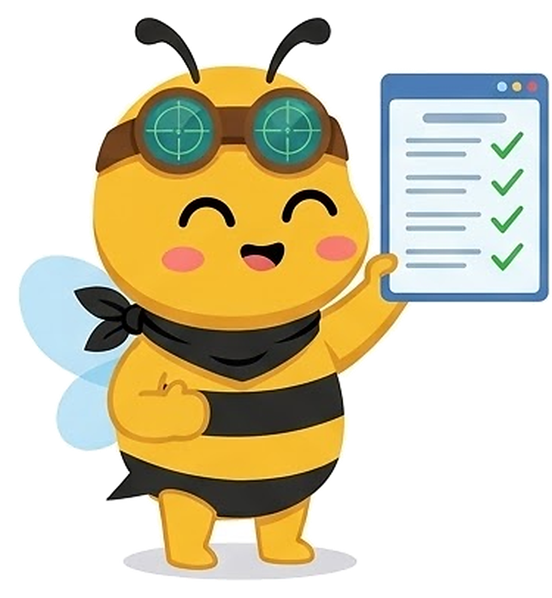 | `maskot-papan-checklist.png` | `checklist.png` | **Kelengkapan Dokumen & Syarat** | Daftar berkas pendaftaran SNBP/mandiri, checklist persyaratan jurusan, to-do list harian pejuang PTN. |
| 14 |  | `maskot-plang-pejuang-ptn.png` | `sign-pejuang.png` | **Sapaan & Sambutan Komunitas** | Hero banner halaman utama, greeting awal dashboard siswa, sambutan hangat grup belajar. |
| 15 |  | `maskot-tunjuk-peta-strategi.png` | `map-pointing.png` | **Pemetaan & Strategi PTN** | Fitur rasionalisasi jurusan, pemetaan kuota penerimaan kampus, strategi pemilihan program studi. |
| 16 | 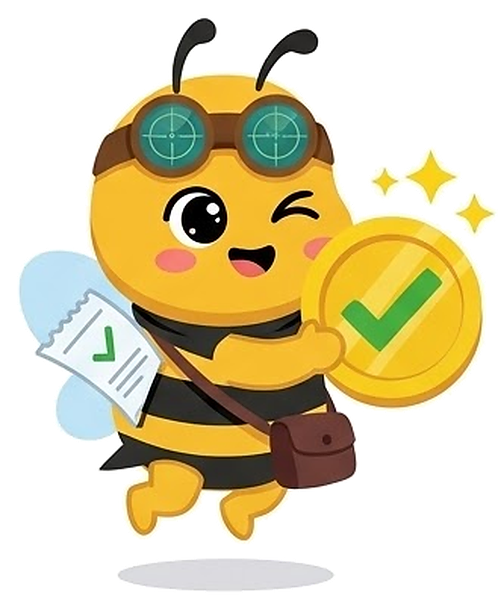 | `maskot-kantong-koin-emas.png` | `coin-bag.png` | **Finansial, Beasiswa & Promo** | Info beasiswa (KIP-K/swasta), estimasi biaya kuliah/UKT, diskon paket bimbel, top up koin/kredit. |
| 17 | 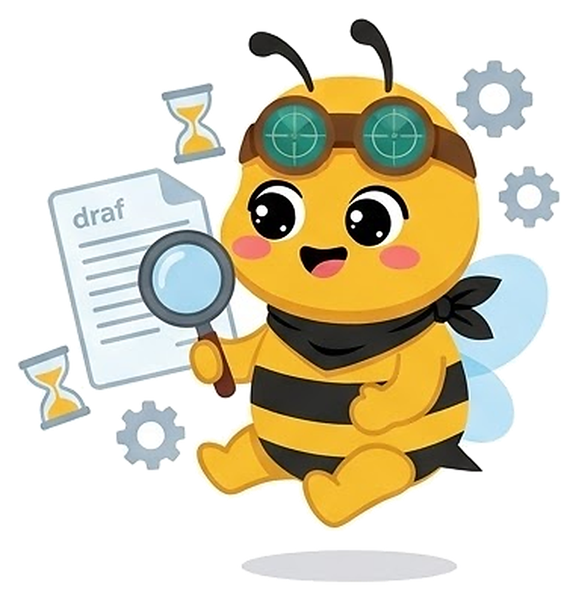 | `maskot-kaca-pembesar-draft.png` | `review-draft.png` | **Deep Review & Audit Esai** | Fitur AI Essay Checker, koreksi grammar & typo, audit portfolio siswa, bedah naskah motivasi. |
| 18 |  | `maskot-melambai-di-pintu-gerbang.png` | `wave-door.png` | **Pintu Masuk & Registrasi** | Halaman Login / Register, gerbang masuk seleksi, pintu awal menuju dunia perkuliahan. |
| 19 | 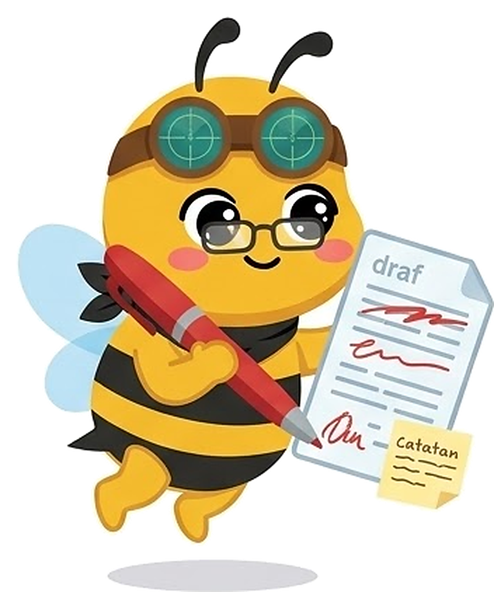 | `maskot-nulis-essay-meja.png` | `writing-essay.png` | **Editor Esai & Pembuatan Konten** | Workspace editor naskah esai, sesi membuat personal statement, tips menulis esai beasiswa. |
| 20 | 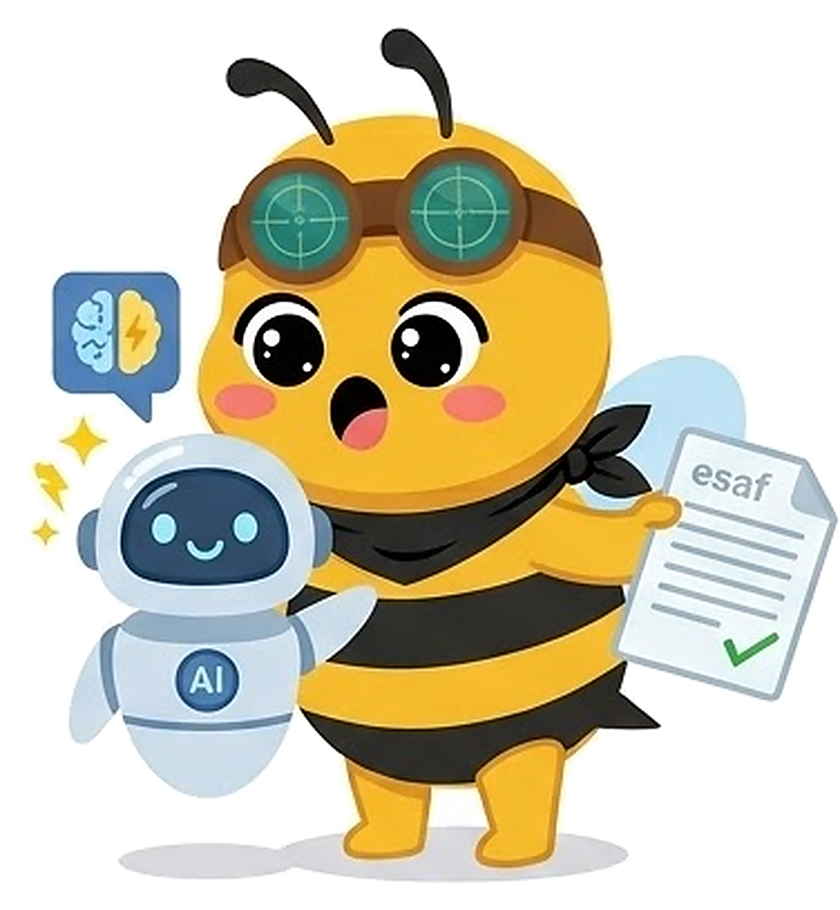 | `maskot-bersama-robot-ai.png` | `ai-robot.png` | **Kecerdasan Buatan & Otomasi** | Fitur AI Assistant Otbee, generator ide otomatis, rekomendasi cerdas berbasis machine learning. |
| 21 |  | `maskot-kalender-deadline.png` | `calendar-zoom.png` | **Jadwal & Countdown Waktu** | Timeline seleksi, hitung mundur (countdown) penutupan pendaftaran, pengingat jadwal tryout. |
| 22 |  | `maskot-grafik-batang-naik.png` | `stats-chart.png` | **Progres & Peningkatan Nilai** | Laporan perkembangan nilai tryout, grafik peningkatan pemahaman, statistik histori latihan soal. |
| 23 | 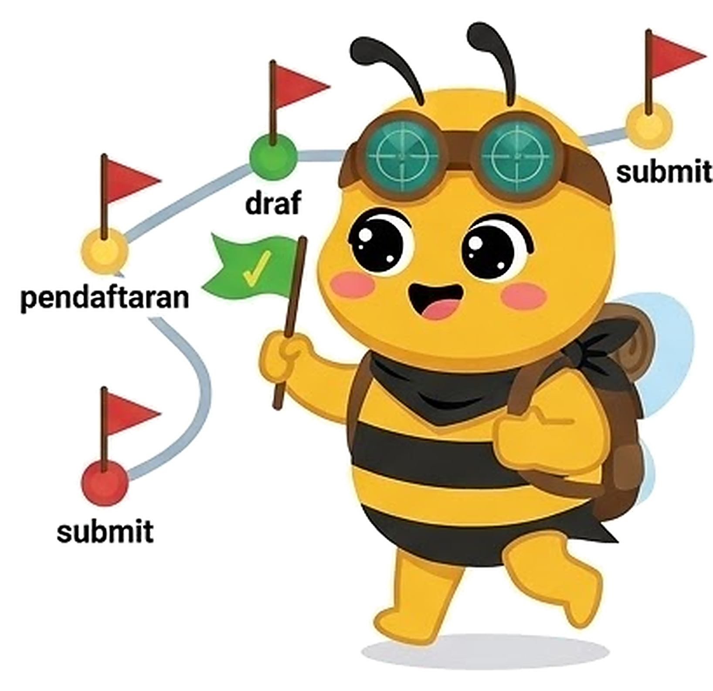 | `maskot-jalan-roadmap-ptn.png` | `journey-path.png` | **Kurikulum & Roadmap 100 Hari** | Timeline tahapan belajar dari nol hingga lolos, peta navigasi seleksi jalur non-tes & SNBT. |
| 24 | 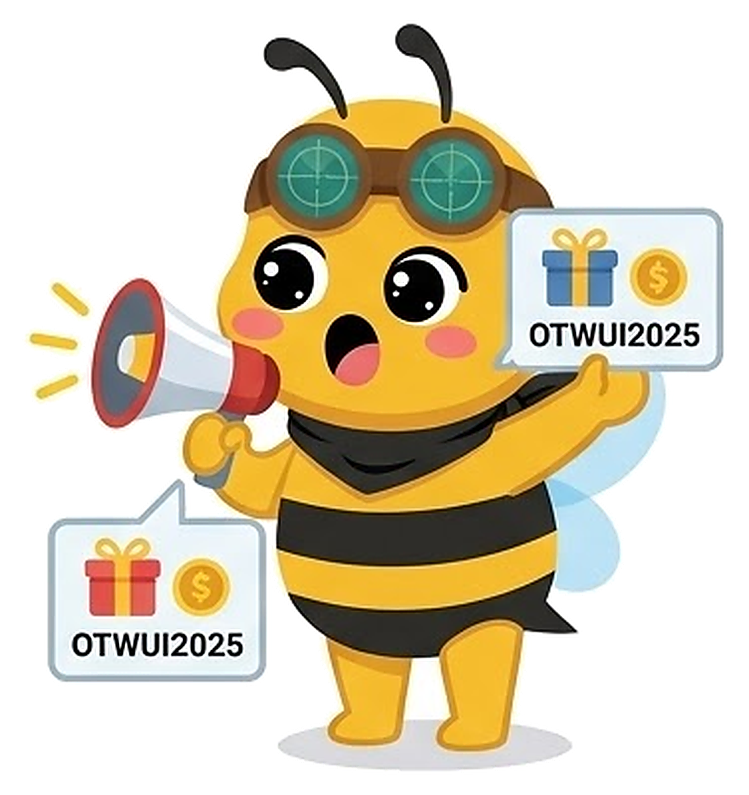 | `maskot-toa-pengumuman-resmi.png` | `announcement.png` | **Pemberitahuan & Broadcast** | Pengumuman resmi dari panitia, broadcast update fitur baru, berita penting pendaftaran PTN. |
| 25 |  | `maskot-medali-emas-prestasi.png` | `medal.png` | **Sertifikat & Portofolio Juara** | Input piagam sertifikat lomba, pencapaian akademik/non-akademik, portofolio unggulan. |
| 26 |  | `maskot-kertas-poin-revisi.png` | `speech-doc.png` | **Feedback & Catatan Mentor** | Catatan koreksi esai dari mentor, saran perbaikan naskah, feedback detail per paragraf. |
| 27 | 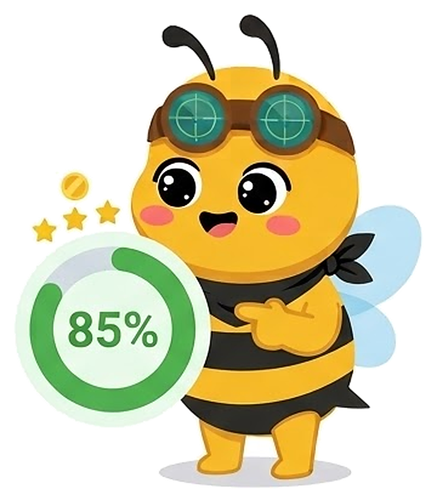 | `maskot-peluang-persentase.png` | `percent-ring.png` | **Kalkulator Peluang & Probabilitas** | Kalkulator rasionalisasi peluang, skor kecocokan rapor dengan jurusan, persentase kelulusan. |
| 28 |  | `maskot-chat-smartphone.png` | `otbee-phone.png` | **Aplikasi Mobile & Chat Otbee** | Konsultasi lewat WhatsApp/aplikasi, notifikasi push mobile, tanya jawab instan dengan AI. |
| 29 |  | `maskot-tablet-video-materi.png` | `tablet-play.png` | **Video Modul & Rekaman Webinar** | Katalog video pembelajaran, rekaman webinar alumni, tutorial langkah demi langkah pendaftaran. |
| 30 |  | `maskot-toa-komunitas.png` | `megaphone-community.png` | **Forum & Komunitas Belajar** | Halaman komunitas Discord/Telegram, ruang diskusi sesama pejuang, grup belajar bareng. |
| 31 | 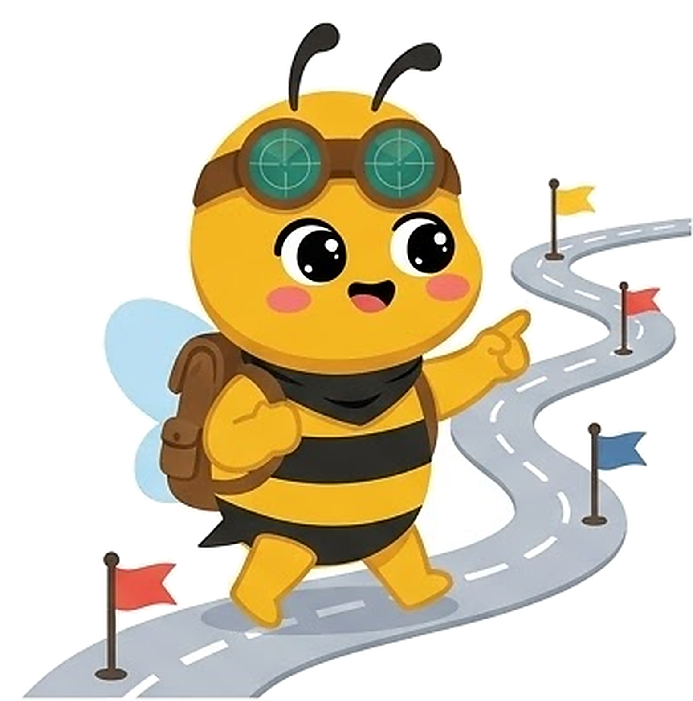 | `maskot-bendera-milestone.png` | `roadmap-flags.png` | **Pencapaian Target & Checkpoint** | Tahapan selesai, milestone roadmap tercapai, status progress belajar 100%, checkpoint lulus tahap 1. |
| 32 |  | `maskot-kotak-arsip-dokumen.png` | `file-box-storage.png` | **Penyimpanan Dokumen & Berkas** | Brankas dokumen siswa, tempat simpan sertifikat & rapor, folder berkas siap download. |
| 33 | 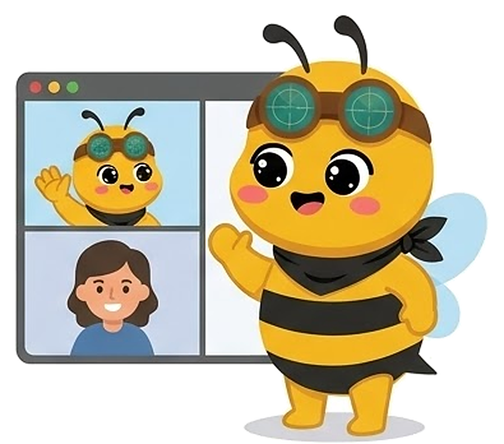 | `maskot-video-call-mentor.png` | `video-call-match.png` | **Mentoring Live & Omegle Belajar** | Fitur Cari Teman Belajar (Omegle edukasi), sesi Google Meet bareng mentor, simulasi wawancara. |
| 34 |  | `maskot-bimbingan-catatan-mentor.png` | `mentor-call-notes.png` | **Konsultasi & Catatan Bimbingan** | Hasil konsultasi 1-on-1, arahan mentor alumni, rangkuman sesi tanya jawab, panduan personal. |
| 35 |  | `maskot-download-materi-folder.png` | `folder-download.png` | **Unduh Berkas & Modul PDF** | Tombol download template esai, unduh bank soal & kunci jawaban, simpan laporan analisis. |
| 36 |  | `maskot-bintang-cemerlang.png` | `star-sparkle.png` | **Rating Bintang 5 & Fitur Unggulan** | Testimoni pengguna, fitur premium rekomendasi teratas, nilai sempurna, kepuasan belajar. |
| 37 |  | `maskot-lompat-pegang-kertas.png` | `jump-paper.png` | **Esai Selesai & Semangat** | Esai berhasil di-submit, tugas selesai tepat waktu, notifikasi 'Siap Diperiksa', semangat belajar. |
| 38 |  | `maskot-koreksi-kertas-senang.png` | `check-paper-happy.png` | **Hasil Review & Validasi Lengkap** | Ringkasan onboarding selesai, validasi dokumen 100%, verifikasi profil siswa komplit. |
| 39 | 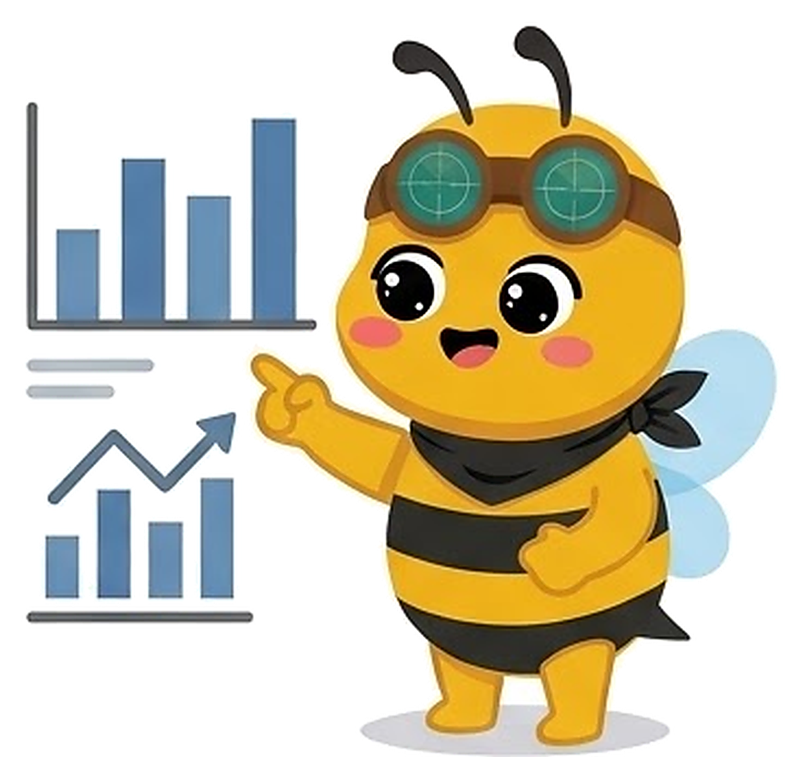 | `maskot-tunjuk-diagram-batang.png` | `bar-chart-point.png` | **Analitik Nilai & Passing Grade** | Analisis rapor semester 1-5, perbandingan passing grade antar kampus, grafik komparasi minat. |
| 40 |  | `maskot-jam-timer-belajar.png` | `reading-clock.png` | **Timer, Pomodoro & Manajemen Waktu** | Sesi nulis terfokus 25 menit (Pomodoro), timer pengerjaan tryout, manajemen waktu belajar efektif. |
| 41 |  | `maskot-bagikan-share-link.png` | `share-icon.png` | **Share Sosial Media & Referral** | Tombol bagikan hasil tryout ke media sosial, ajak teman belajar bareng, program referral beasiswa. |
| 42 |  | `maskot-headset-sapa.png` | `headset-wave.png` | **Audio Podcast & Voice Room** | Podcast seputar perkuliahan, panduan audio motivasi, sapaan di ruang voice chat belajar. |
| 43 |  | `maskot-peluk-bantal-ngantuk.png` | `sleep-pillow.png` | **Kelelahan & Waktu Istirahat** | Pengingat 'Jangan lupa istirahat!', sesi belajar larut malam selesai, status akun idle/offline. |
| 44 |  | `maskot-terbang-pesawat-kertas.png` | `paper-plane-fly.png` | **Kirim Esai & Terbangkan Impian** | Tombol kirim/submit final pendaftaran, animasi pengiriman esai ke tim reviewer, kirim doa & harapan. |
| 45 |  | `maskot-kacamata-baca-meja.png` | `glasses-writing-desk.png` | **Riset Jurusan & Mode Serius** | Bedah jurusan kritis, riset akreditasi & prospek kerja, analisis mendalam profil kampus. |
| 46 |  | `maskot-lompat-bawa-piala.png` | `trophy-jump.png` | **Prestasi Tryout & Juara Kelas** | Skor tryout tembus target, peringkat 1 tryout akbar, lencana prestasi terselesaikan. |
| 47 |  | `maskot-duduk-awan-bintang.png` | `cloud-star-sit.png` | **Cita-Cita & Visi Masa Depan** | Dream campus goal tracker, visualisasi cita-cita kuliah, renungan masa depan, motivasi spiritual. |
| 48 | 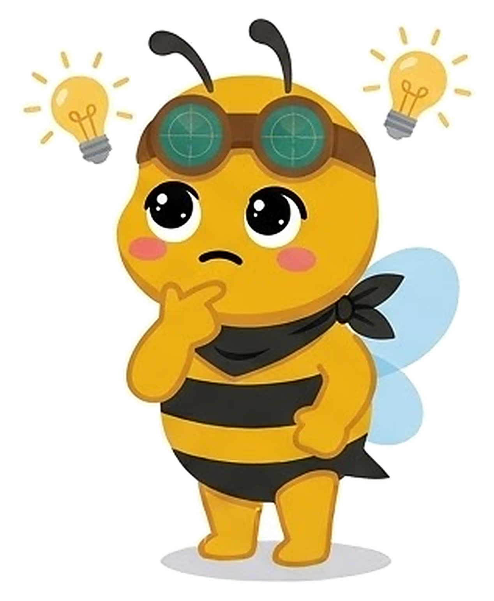 | `maskot-ide-bohlam-lampu.png` | `thinking-idea.png` | **Tips, Inspirasi & Solusi Cerdas** | Tips & trik lolos PTN, inspirasi topik esai kreatif, 'Tahukah Kamu?', insight strategis baru. |
| 49 |  | `maskot-fitur-mentor-alumni.png` | `mentor-alumni.png` | **Fitur Mentor Alumni** | Halaman bimbingan alumni, profil mentor PTN, jadwal konsultasi privat alumni |
| 50 |  | `maskot-fitur-essay-ai-review.png` | `essay-ai-review.png` | **Fitur Essay AI Review** | Layanan review esai instan AI, deteksi kelemahan naskah, scoring grammar & struktur |
| 51 |  | `maskot-fitur-kalkulator-peluang.png` | `kalkulator-peluang.png` | **Fitur Kalkulator Peluang** | Kalkulator rasionalisasi nilai rapor, analisis passing grade, probabilitas lolos jurusan |
| 52 |  | `maskot-fitur-otbee-ai.png` | `otbee-ai.png` | **Fitur Otbee AI** | Chatbot konsultan pintar Otbee AI, rekomendasi kampus personal, generator ide esai |
| 53 |  | `maskot-fitur-modul-video.png` | `modul-video.png` | **Fitur Modul & Video** | Katalog modul pelajaran SNBT/non-tes, video bedah materi, rekaman kelas intensif |
| 54 |  | `maskot-fitur-komunitas.png` | `komunitas.png` | **Fitur Komunitas Belajar** | Komunitas belajar pejuang PTN, forum diskusi tanya jawab, grup sharing beasiswa |
| 55 |  | `maskot-fitur-tracking-jalur.png` | `tracking-jalur.png` | **Fitur Tracking Jalur Masuk** | Pelacakan jadwal & persyaratan jalur SNBP, SNBT, Mandiri Prestasi, dan Kemitraan |
| 56 |  | `maskot-fitur-penyimpanan-dokumen.png` | `penyimpanan-dokumen.png` | **Fitur Penyimpanan Dokumen** | Brankas dokumen portofolio siswa, tempat simpan sertifikat prestasi & transkrip nilai |
| 57 |  | `maskot-fitur-cari-teman-belajar.png` | `cari-teman-belajar.png` | **Fitur Cari Teman Belajar** | Omegle edukasi, matchmaking teman belajar satu target kampus, room diskusi bareng |
| 58 |  | `maskot-pov-depan-front.png` | `pov-front.png` | **2D Turnaround Sheet (Front)** | Karakter utama beranda, hero section, avatar profil standar, splash screen |
| 59 |  | `maskot-pov-samping-kanan-right.png` | `pov-right.png` | **2D Turnaround Sheet (Right)** | Navigasi maju, animasi berjalan ke kanan, transisi halaman berikutnya (Next step) |
| 60 |  | `maskot-pov-samping-kiri-left.png` | `pov-left.png` | **2D Turnaround Sheet (Left)** | Navigasi kembali (Back step), animasi berjalan ke kiri, layout dua arah |
| 61 |  | `maskot-pov-belakang-back.png` | `pov-back.png` | **2D Turnaround Sheet (Back)** | Halaman logout/selesai, karakter berjalan menjauh, animasi berbalik badan |
| 62 |  | `maskot-pov-atas-top.png` | `pov-top.png` | **2D Turnaround Sheet (Top)** | Peta roadmap interaktif dari atas, game mini edukasi, view orthographic |
| 63 |  | `maskot-pov-tiga-perempat-3-4.png` | `pov-three-quarter.png` | **2D Turnaround Sheet (3/4 Front)** | Pose paling dinamis untuk kartu fitur, landing page, modal dialog informasi |
| 64 |  | `maskot-pov-bawah-bottom.png` | `pov-bottom.png` | **2D Turnaround Sheet (Bottom)** | Animasi melompat di atas user, sudut perspektif bawah, aset 3D turnaround |
| 65 | 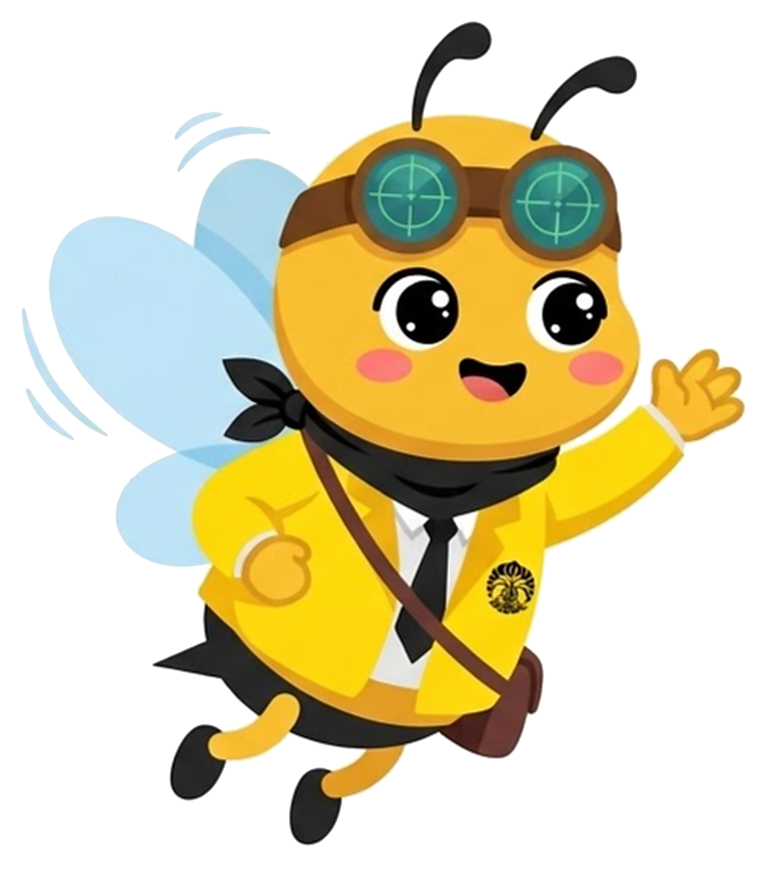 | `maskot-terbang-almet-kuning-ui.png` | `flying-bee-ui.png` | **Almamater & Prestasi UI** | Perayaan seleksi PPKB/SNBP UI, animasi selebrasi di halaman onboarding, hero float |
| 66 | 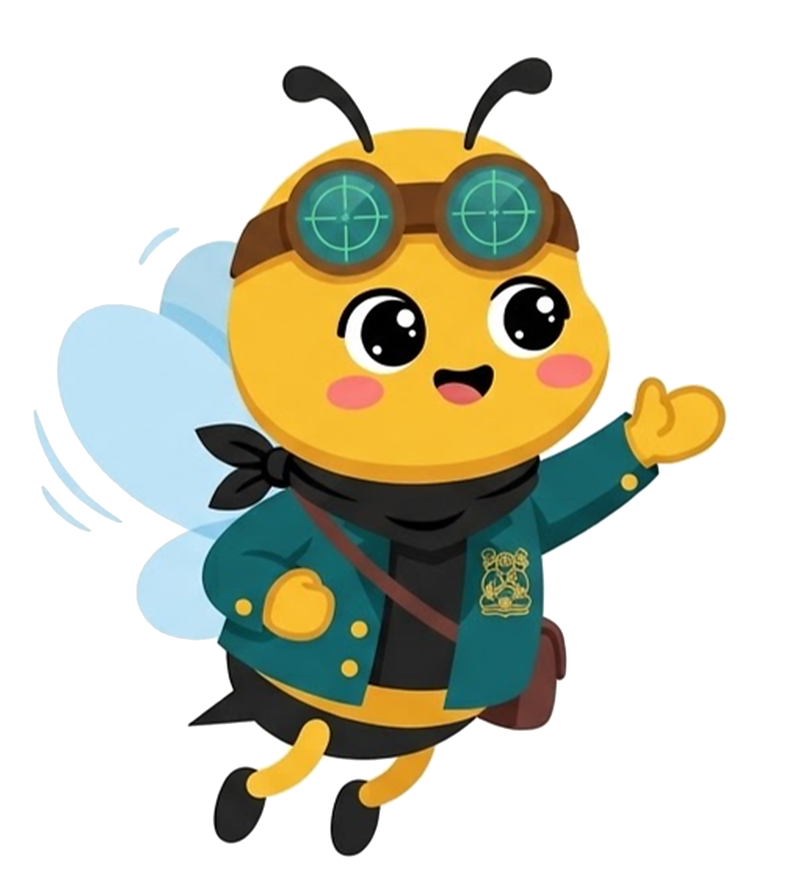 | `maskot-terbang-almet-krem-ugm.png` | `flying-bee-ugm.png` | **Almamater & Prestasi UGM** | Perayaan seleksi PBUB/SNBP UGM, selebrasi lolos PTN impian, hero float |
| 67 | 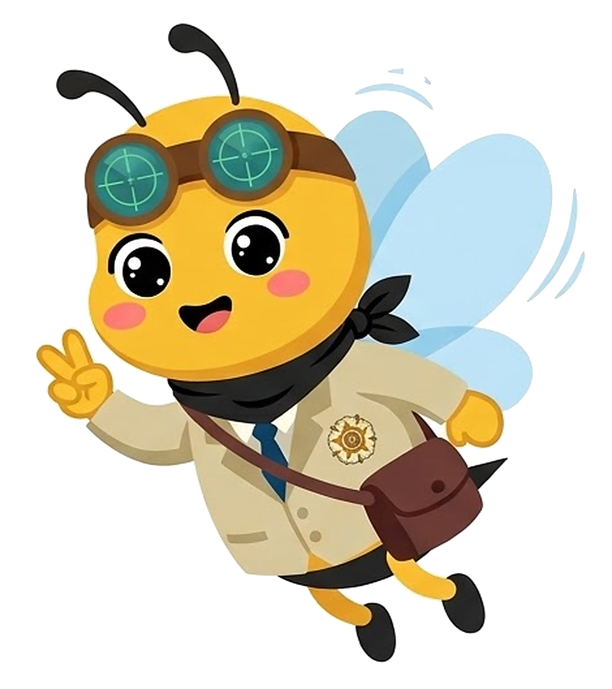 | `maskot-terbang-almet-toska-itb.png` | `flying-bee-itb.png` | **Almamater & Prestasi ITB** | Perayaan seleksi SNBP/Mandiri ITB, selebrasi lolos kampus teknik teratas, hero float |
| 68 | 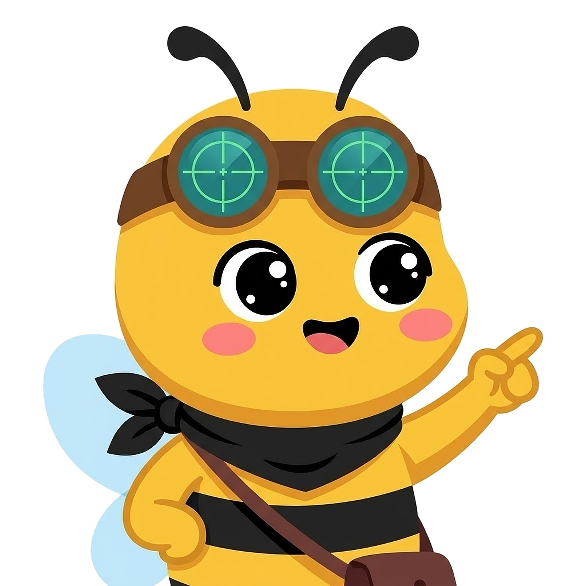 | `maskot-avatar-tunjuk-kanan.png` | `otbee-avatar-pointing.png` | **Avatar & Panduan Aksi** | Avatar pemandu form onboarding, banner rekomendasi fitur, dialog interaktif |
| 69 |  | `maskot-lanjutkan-draft-essay.png` | `lanjutkan-essay.png` | **Editor & Review Esai** | Card Lanjutkan Esai di dashboard siswa, pengingat draft belum selesai, review mentor |
| 70 |  | `maskot-upgrade-bintang-emas.png` | `upgrade-paket.png` | **Monetisasi & Paket Premium** | Modal upgrade ke paket Pro, fitur premium terkunci, promo membership tahun ajaran baru |
| 71 | 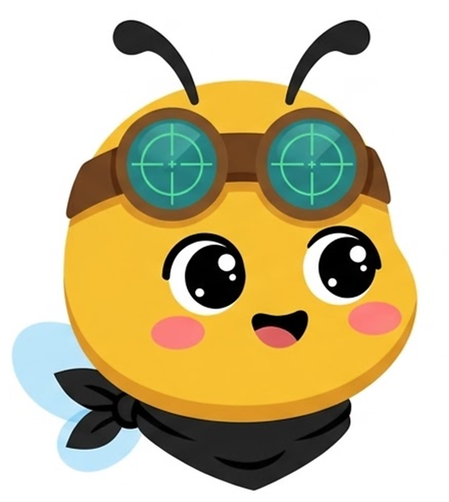 | `maskot-kepala-logo-avatar.png` | `otbee-logo-head.png` | **Avatar & Identitas Brand** | Favicon, avatar profil default pengguna, logo navbar kecil, app icon mobile |
| 72 | 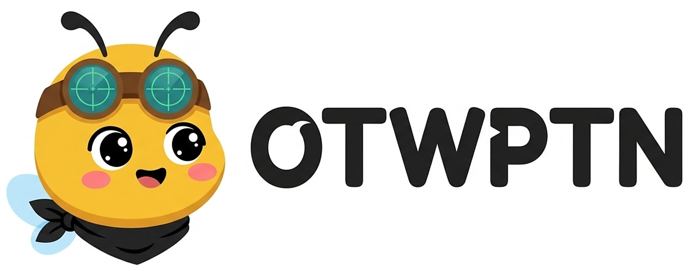 | `maskot-brand-logo-otwptn.png` | `logo-otwptn-hd.png` | **Identitas Brand & Logo** | Navbar utama aplikasi web, footer brand, invoice resmi, header dokumen sertifikat |
| 73 | 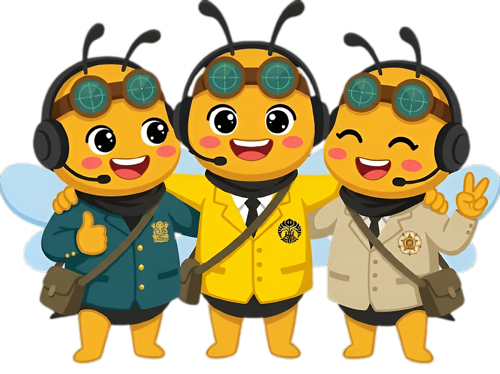 | `maskot-trio-mentor-headset.png` | `trio-mentor.png` | **Komposisi Tim Mentor** | Header section mentor alumni di landing page, banner profil konsultan bimbel |
| 74 | 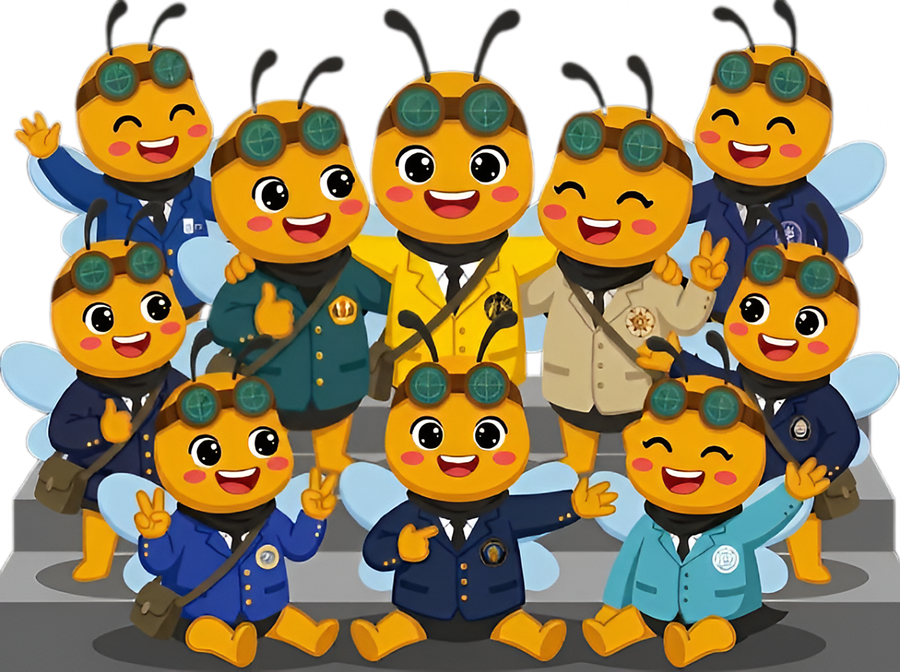 | `maskot-grup-tangga-almamater.png` | `group-tangga-almamater.png` | **Komposisi Komunitas Akbar** | Banner akbar pejuang PTN se-Indonesia, footer besar, section Alumni Kami di Berbagai Kampus |
| 75 | 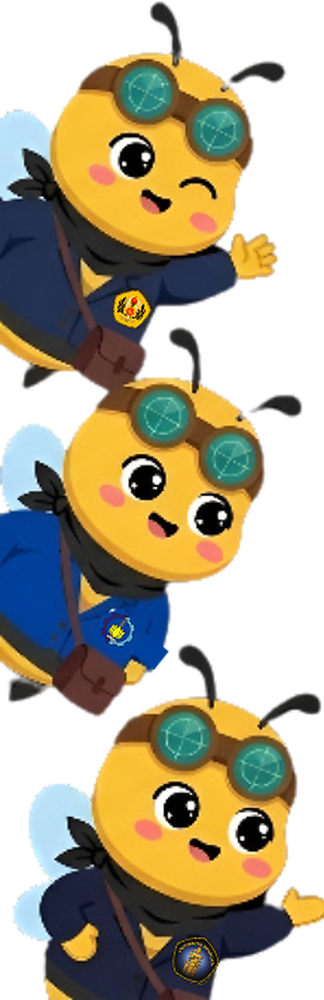 | `maskot-hero-intip-kiri.png` | `hero-kiri-hd.png` | **Framing Hero Banner** | Dekorasi sisi kiri hero banner halaman utama, dekorasi layar lebar |
| 76 |  | `maskot-hero-intip-kanan.png` | `hero-kanan-hd.png` | **Framing Hero Banner** | Dekorasi sisi kanan hero banner halaman utama, dekorasi layar lebar |
| 77 |  | `maskot-hero-baris-bawah-desktop.png` | `hero-bawah-desktop-hd.png` | **Framing Hero Banner** | Dekorasi sisi bawah hero banner desktop, pembatas section beranda |
| 78 |  | `maskot-hero-baris-bawah-mobile.png` | `hero-bawah-mobile-hd.png` | **Framing Hero Banner (Mobile)** | Dekorasi sisi bawah hero banner pada tampilan HP / smartphone responsif |

---

## 🏷️ Pengelompokan Berdasarkan Kategori & Halaman

### 🚀 1. Fitur Utama Platform (`/public/fitur/`)
- `maskot-fitur-mentor-alumni.png`: Modul bimbingan alumni & konsultasi privat
- `maskot-fitur-essay-ai-review.png`: Evaluasi esai instan oleh AI
- `maskot-fitur-kalkulator-peluang.png`: Kalkulator rasionalisasi nilai & passing grade
- `maskot-fitur-otbee-ai.png`: AI Copilot asisten belajar siswa
- `maskot-fitur-modul-video.png`: Modul pelajaran & video rekaman
- `maskot-fitur-komunitas.png`: Ruang obrolan pejuang PTN se-Indonesia
- `maskot-fitur-tracking-jalur.png`: Roadmap & tracking pendaftaran semua jalur
- `maskot-fitur-penyimpanan-dokumen.png`: Brankas berkas rapor & piagam aman
- `maskot-fitur-cari-teman-belajar.png`: Omegle teman belajar satu minat kampus

### 🔄 2. Karakter Turnaround 360° / 2D POVs
- `maskot-pov-depan-front.png`: Tampilan depan simetris untuk splash screen / hero
- `maskot-pov-samping-kanan-right.png`: Animasi melangkah maju / next step
- `maskot-pov-samping-kiri-left.png`: Navigasi kembali / back step
- `maskot-pov-belakang-back.png`: Logout / selesai aktivitas
- `maskot-pov-atas-top.png`: Peta interaktif / gamifikasi
- `maskot-pov-tiga-perempat-3-4.png`: Kartu fitur dinamis / modal popup info
- `maskot-pov-bawah-bottom.png`: Sudut pandang bawah / aksi melompat

### 🐝 3. Lebah Terbang Jas Almamater (Selebrasi)
- `maskot-terbang-almet-kuning-ui.png` (`bee1-hd.png`): Lolos UI, selebrasi onboarding
- `maskot-terbang-almet-krem-ugm.png` (`bee2-hd.png`): Lolos UGM, selebrasi penerimaan
- `maskot-terbang-almet-toska-itb.png` (`bee3-hd.png`): Lolos ITB, selebrasi kelulusan

### 🌟 4. Aksi Spesifik Dashboard & Monetisasi
- `maskot-lanjutkan-draft-essay.png`: Card melanjutkan penulisan draft esai
- `maskot-upgrade-bintang-emas.png`: Penawaran upgrade paket membership premium
- `maskot-avatar-tunjuk-kanan.png`: Pemandu langkah form biodata siswa
- `maskot-kepala-logo-avatar.png`: Favicon & foto profil default pengguna
- `maskot-brand-logo-otwptn.png`: Logo resmi OTWPTN resolusi tinggi

### 👥 5. Komposisi Kelompok & Hero Banner
- `maskot-trio-mentor-headset.png`: Tiga mentor saling merangkul untuk section tim
- `maskot-grup-tangga-almamater.png`: Sepuluh pejuang almamater di tangga kampus
- `maskot-hero-intip-kiri.png`: Hiasan mengintip dari sisi kiri banner beranda
- `maskot-hero-intip-kanan.png`: Hiasan mengintip dari sisi kanan banner beranda
- `maskot-hero-baris-bawah-desktop.png`: Deretan maskot di pembatas banner desktop
- `maskot-hero-baris-bawah-mobile.png`: Deretan maskot responsif di HP

---
*Dihasilkan secara otomatis oleh Antigravity Pipeline untuk ekosistem OTWPTN.*
